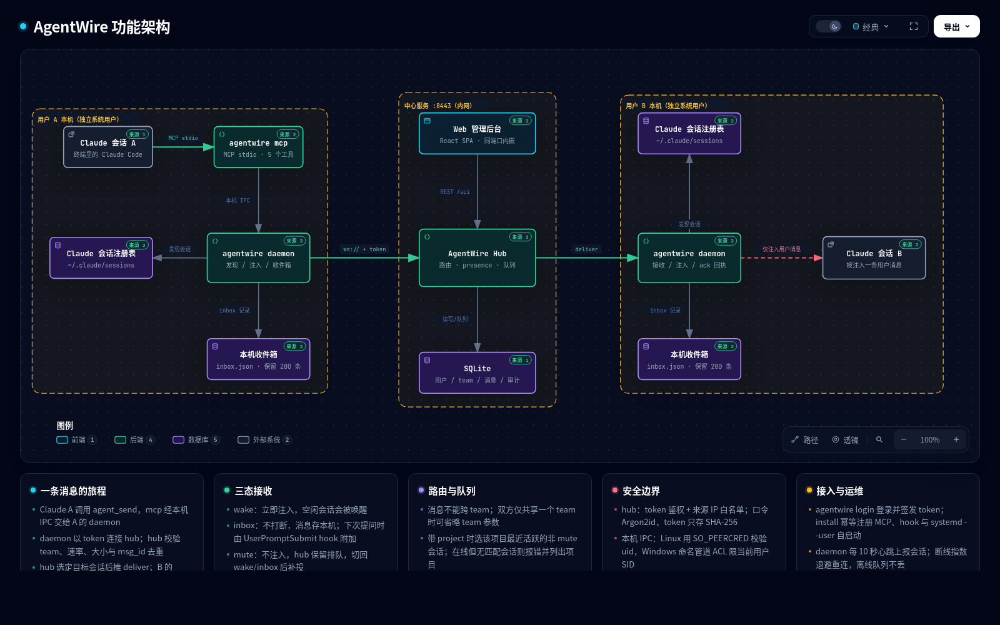

# AgentWire

> Your team's agents, on one wire.

AgentWire connects Claude Code sessions across **different OS users**. Claude Code's built-in cross-session messaging is scoped to a single Unix uid; AgentWire adds a hub plus a per-user daemon so colleagues' sessions can message each other without leaving the terminal.

> **Status**: 0.1.x. Linux wake/inbox/mute injection has been verified against a real Claude Code 2.1.317 session; Windows is cross-compiled but not yet validated on hardware.

[](https://htmlpreview.github.io/?https://github.com/QuanjieDeng/AgentWire/blob/master/docs/architecture.html)

> Click the diagram for the interactive version; static image: [docs/architecture.png](docs/architecture.png).

Messages are always delivered as an ordinary user message. AgentWire cannot approve permissions, change session settings, or trigger tool calls on the target session.

Full documentation (Chinese): [README.md](README.md) · Design: [SPEC.md](SPEC.md)

## Features

- Five MCP tools: members, send, broadcast, receive mode, local inbox
- Project-aware routing and "most recently active session" fallback
- Three receive modes: `wake`, `inbox`, `mute`
- 7-day offline queue with delivery receipts and expiry notices
- At-least-once delivery with `msg_id` deduplication; per-sender ordering
- Teams, invites, roles, presence, rate limiting, audit without message bodies
- Single Go binary + embedded React admin console

## Architecture

```
Claude session A ── MCP stdio ── agentwire mcp ── local IPC ── daemon (user A)
                                                                  │ ws://
                                                             AgentWire hub ── SQLite
                                                                  │ ws://
Claude session B ── MCP stdio ── agentwire mcp ── local IPC ── daemon (user B)
```

The hub routes messages only within a team. The target daemon injects two line-delimited
JSON frames into the target Claude session's local messaging channel:

```json
{"type":"auth","token":"<peer token>"}
{"type":"user","message":{"role":"user","content":"<agentwire-message …>…</agentwire-message>"}}
```

## Requirements

- Hub: Linux recommended; Go 1.26+ to build
- Client: Linux or Windows, Claude Code **2.1.224+**
- Web build (only when changing `web/`): Node.js 20+
- Network: trusted LAN; plaintext `ws://` by design (put TLS in front if needed)

## Build

The repository already contains the built web console (`internal/webui/dist/`), so
building the binary does **not** require Node.js:

```bash
go build -o bin/agentwire ./cmd/agentwire

# Windows
GOOS=windows GOARCH=amd64 go build -o bin/agentwire.exe ./cmd/agentwire
```

Rebuild the web console only if you changed sources under `web/` (Node.js 20+):

```bash
cd web && npm ci && npm run build && cd ..
```

> `EBADENGINE` or `SyntaxError: Unexpected token '?'` means Node is older than 18.
> Skip the frontend build and use the committed `dist`, or upgrade to Node 20 LTS.

## Quick start (hub + first user)

```bash
# 1. First admin (interactive password, never on the command line)
./bin/agentwire admin init --db ./agentwire.db --username admin

# 2. Start hub
./bin/agentwire serve \
  --addr :8443 \
  --db ./agentwire.db \
  --allow-ip 10.0.0.0/8

# 3. Log in and install on the client machine
./bin/agentwire login --server http://<hub>:8443 --username admin
./bin/agentwire install

# 4. Restart Claude Code (MCP servers load at session start)
```

`install` registers the MCP server for user scope, adds a `UserPromptSubmit` hook, and
sets up daemon autostart (`systemd --user` on Linux; the `schtasks` command is printed on
Windows). Use `--project` to register MCP in the current repo instead, or `--no-service`
to skip autostart.

Create a team in the web console (`http://<hub>:8443/` → Teams → create, e.g. `myteam`),
then verify in a new Claude session:

> Use agent_members for myteam and agent_inbox.

## AI-assisted install (copy this prompt)

Paste the prompt below into Claude Code (or any agent that can run commands), replace the
two `<...>` placeholders, and send it. It builds AgentWire, registers the MCP server and
hook, asks you to log in, and starts the daemon.

```text
You are on a developer machine that needs to connect to AgentWire. Install the local MCP
and start the daemon so Claude Code can use the agent_* tools.

My details:
- Hub URL: <http://hub:8443>
- Username: <my username>
- Repo path: <leave blank for ~/AgentWire>

Execute in order. If any step fails, stop and report the raw error.

1. Prerequisites
   - `claude --version` >= 2.1.224
   - `go version` >= 1.26
   - If either is missing, stop and tell me what to install.

2. Fetch and build
   - Clone https://github.com/QuanjieDeng/AgentWire.git to ~/AgentWire if the repo path
     is missing.
   - The repo already contains internal/webui/dist/index.html, so Node.js is usually
     not needed. Only if that file is missing:
     `cd web && npm ci && npm run build && cd ..` (requires Node.js 20+)
   - `go build -o bin/agentwire ./cmd/agentwire`

3. Install to a stable path
   - Linux: `mkdir -p ~/.local/bin && install -m 0755 bin/agentwire ~/.local/bin/agentwire`
   - Windows: use the absolute path to bin\agentwire.exe
   - Use this stable path for the remaining commands.

4. Register MCP, hook and daemon autostart
   - Run `agentwire install`
   - If no systemd user session is available, use `agentwire install --no-service` and
     tell me to run the daemon manually.
   - This runs `claude mcp add -s user` and appends a UserPromptSubmit hook to
     ~/.claude/settings.json. Do not change anything else.

5. Login (I must do this myself)
   - Give me this command to run in my own terminal; do not run it with a pipe,
     environment variable, or --password:
     `agentwire login --server <url> --username <username>`
   - I will type the password. Never ask me to paste the password or token into the chat,
     and never read or print tokens or .key files.
   - After I confirm, check that ~/.config/agentwire/config.json exists (Windows:
     %AppData%\agentwire\config.json; existence only, do not print it).

6. Start and verify
   - With systemd: `systemctl --user enable --now agentwire-daemon`
   - Otherwise ask me to run `agentwire daemon` in a persistent terminal.
   - Verify `claude mcp list` contains agentwire; on Linux
     `systemctl --user is-active agentwire-daemon` is active and
     $XDG_RUNTIME_DIR/agentwire/daemon.sock exists.
   - Right after login the daemon may still be in its 5-second restart wait; retry the
     check once after a few seconds.

7. Report
   - Whether MCP is registered, whether the daemon is online, and that I must restart
     Claude Code to see the agent_* tools.
   - Do not call any agent_* tool in this session.
```

`install` only touches the AgentWire repo, the hook entry in `~/.claude/settings.json`,
and the Claude MCP registration. The password and token stay in your terminal. Restart
Claude Code after installing so the MCP tools load.

## Adding teammates

1. Open `http://<hub>:8443/`, log in as admin.
2. **Users → create user** gives a one-time initial password.
3. **Teams → create team**, then generate an invite code — or add members directly by
   username (team owner or platform admin). Platform admins see every team and can manage
   members without joining it first.
4. Each teammate, under their own OS user:

```bash
agentwire login --server http://<hub>:8443 --username <name>
agentwire install
```

5. Join the team in the web console with the invite code, then restart Claude Code.

## MCP tools

| Tool | Description |
| --- | --- |
| `agent_members(team?)` | Team members, roles, online sessions, project, idle/busy, mode |
| `agent_send(to, text, team?, project?)` | Non-blocking send; returns `msg_id` and status |
| `agent_broadcast(text, team?)` | Fan out to all online sessions in a team |
| `agent_mode(mode)` | Set this session's receive mode: `wake` / `inbox` / `mute` |
| `agent_inbox()` | Last 50 local sent/received records and delivery receipts |

Delivery statuses: `delivered`, `queued`, `held`, `refused`, `expired`, `error`.
Messages are capped at 8 KB and 5 sends/second per user. The offline queue keeps messages
for 7 days.

`team` may be omitted when both parties share exactly one team. `project` uses the git
repository root name (fallback: cwd directory name). Without `project`, the most recently
active online session is selected.

## Receive modes

| Mode | Behavior |
| --- | --- |
| `wake` (default) | Inject immediately; wakes idle sessions |
| `inbox` | Store locally without waking; the `UserPromptSubmit` hook attaches unread messages to the next prompt |
| `mute` | Do not inject; keep the message queued server-side until the mode changes |

Claude Code's `crossSessionInbound` setting controls what happens on the receiving side:
`accept` injects, `hold` waits for the user's approval, `refuse` rejects.

## Configuration

Linux defaults (all XDG variables are honored):

| Data | Path |
| --- | --- |
| Config | `~/.config/agentwire/config.json` (0600) |
| Modes | `~/.local/state/agentwire/modes.json` |
| Local inbox | `~/.local/state/agentwire/inbox.json` |
| Local IPC | `$XDG_RUNTIME_DIR/agentwire/daemon.sock` |

Windows: `%AppData%\agentwire\config.json` and the named pipe
`\\.\pipe\agentwire-<user SID>`.

## Security model

- Argon2id passwords; tokens and invite codes are stored only as hashes
- Source IP allowlist, login rate limiting, forced first-login password change
- Local IPC authenticated by `SO_PEERCRED` (Linux) or a current-user-only pipe ACL (Windows)
- Audit stores metadata only, never message bodies
- Plaintext transport is an accepted trade-off for isolated internal networks

Do not expose the hub to the public internet. See the Chinese README for deployment,
backup, troubleshooting, and the full security discussion.

## Development

```bash
go vet ./...
go test ./... -count=1
GOOS=windows GOARCH=amd64 go build ./...
```

Tests exercise three protocol seams: a real WebSocket hub with temp SQLite, a fake Claude
channel over a real Unix socket, and the MCP stdio bridge.

## Known limitations

No attachments, end-to-end encryption, clustering/HA, SSO, web chat, or cross-team
messages. Windows has not been validated on real hardware. The injection protocol relies
on Claude Code internals and may change across versions.

## License

No license has been added yet. Choose one (MIT / Apache-2.0 / AGPL-3.0) before publishing.
