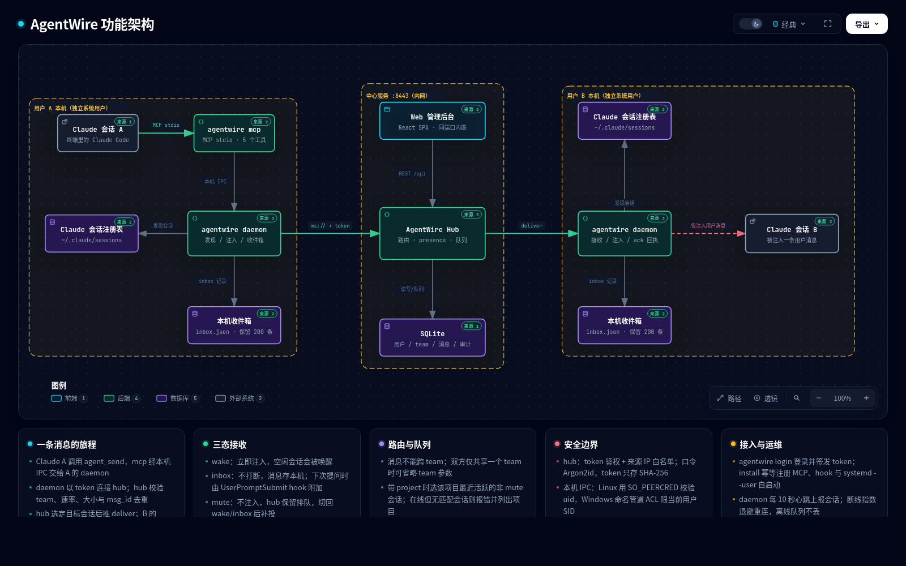

# AgentWire

> Your team's agents, on one wire.

[English](README.en.md)

把**不同系统用户**的 Claude Code 会话连起来：同事之间可以直接让各自的 Claude 互相发消息、同步进度、交接工作、互相 review，而不必离开终端去聊天软件里找人。

Claude Code 自带的跨会话消息只在同一个系统用户内有效。AgentWire 用一个中心服务和每用户一个本机 daemon 补上这一层：消息永远是**一条普通用户消息**，不会代替对方批准权限、不会产生工具调用。

- 中心服务：Go + WebSocket + SQLite（纯 Go，无 CGO）
- 客户端：`agentwire daemon`（Linux systemd --user / Windows 登录启动）+ MCP 工具
- 管理后台：React + TypeScript，内嵌在同一个二进制里
- 支持 Linux 与 Windows；macOS 可编译但未验证

> **状态**：0.1.x。Linux 端的 `wake` / `inbox` / `mute` 已在真实 Claude Code 2.1.317 会话上完成注入与唤醒验证；Windows 仅完成交叉编译，尚未实机验证。

[](https://htmlpreview.github.io/?https://github.com/QuanjieDeng/AgentWire/blob/master/docs/architecture.html)

> 点击架构图查看可交互版本；静态大图见 [docs/architecture.png](docs/architecture.png)。

详细设计见 [SPEC.md](SPEC.md)。

---

## 目录

- [它解决什么问题](#它解决什么问题)
- [特性](#特性)
- [架构](#架构)
- [环境要求](#环境要求)
- [快速开始](#快速开始)
- [用 AI 安装（提示词）](#用-ai-安装提示词)
- [多人使用](#多人使用)
- [MCP 工具](#mcp-工具)
- [接收模式](#接收模式)
- [路由规则](#路由规则)
- [Web 管理后台](#web-管理后台)
- [CLI 参考](#cli-参考)
- [生产部署](#生产部署)
- [配置与数据](#配置与数据)
- [安全模型](#安全模型)
- [故障排查](#故障排查)
- [开发与测试](#开发与测试)
- [已知限制](#已知限制)
- [贡献](#贡献)

---

## 它解决什么问题

团队在同一台内网机器上以「每人一个系统用户」的方式使用 Claude Code。Claude Code 的会话注册表、消息 socket 和 uid 白名单都把其他同事挡在外面：

- 同一个人的多个会话能互相说话
- 同事之间的会话完全隔离

结果是同仓库协作时，进度同步、工作交接、互相 review、避免撞车只能靠人肉复制粘贴。AgentWire 让各自的 Claude 直接完成这件事。

## 特性

- **五个 MCP 工具**：列出团队、发消息、团队广播、设置接收模式、查看收件箱
- **按项目路由**：可指定「某人在某个项目下的会话」，不指定则发给对方最近活跃的会话
- **三态接收**：`wake` 立即唤醒、`inbox` 只收件不打断、`mute` 服务端排队
- **离线队列**：消息保留 7 天，对方上线自动补投，发送方收到送达/过期回执
- **投递语义**：at-least-once + `msg_id` 去重；同一发送方到同一接收方保序
- **可追溯**：审计记录时间、双方、team、大小、结果、来源 IP，**不保存正文**
- **团队管理**：邀请码（有效期 + 使用上限）、成员移除、team 归档、owner 统计
- **多 team**：同一用户可属于多个 team；消息不跨 team
- **中文界面**：CLI 提示、Web 后台、错误信息全中文

## 架构

```
┌─────────────────┐        MCP stdio         ┌──────────────────────┐
│ Claude 会话 A   │ ◄──────────────────────► │ agentwire mcp        │
└─────────────────┘                          └──────────┬───────────┘
                                                        │ 本机 IPC
                                             ┌──────────▼───────────┐
                                             │ agentwire daemon     │  ← 用户 A
                                             │ 会话发现 / 注入 / 收件箱│
                                             └──────────┬───────────┘
                                                        │ ws:// (token)
                                          ┌─────────────▼─────────────┐
                                          │      AgentWire hub        │
                                          │ 路由 / presence / 队列     │
                                          │ SQLite / 审计 / Web 后台   │
                                          └─────────────┬─────────────┘
                                                        │ ws:// (token)
                                             ┌──────────▼───────────┐
                                             │ agentwire daemon     │  ← 用户 B
                                             └──────────┬───────────┘
                                                        │ 本机 Claude 消息通道
                                             ┌──────────▼───────────┐
                                             │ Claude 会话 B        │
                                             └──────────────────────┘
```

一条消息的旅程：

1. Claude 会话 A 调用 `agent_send` → `agentwire mcp` 通过本机 IPC 交给 A 的 daemon
2. daemon 通过 WebSocket 发给 hub（携带 token 和发送会话 id）
3. hub 校验 team、速率、大小、去重，选择 B 的在线会话
4. hub 把 `deliver` 帧推给 B 的 daemon
5. B 的 daemon 连接目标会话的本地消息通道，写入 `auth` + `user` 两帧
6. 目标 Claude 看到一条带 `<agentwire-message>` 封套的用户消息
7. 目标 daemon 回报 `delivered` / `held` / `refused`，hub 通知发送方

## 环境要求

| 组件 | 要求 |
| --- | --- |
| 中心服务 | Linux（推荐）、Windows Server、macOS 均可运行；Go 1.26+ 构建 |
| 客户端 | Linux 或 Windows；需要 Claude Code **2.1.224+**（跨会话消息） |
| 构建 Web 后台（可选） | Node.js 20+ 与 npm；仅在修改 `web/` 源码时需要 |
| 网络 | 内网；hub 默认监听 `:8443`，明文 `ws://` |

> macOS 客户端可以编译，但命名管道/权限校验未在真实环境验证；不建议生产使用。

## 快速开始

以下命令先让**一个人**把服务和自己接起来，验证链路。完整多人流程见下一节。

### 1. 构建

仓库已经包含构建好的 Web 后台（`internal/webui/dist/`），直接编译二进制即可，**不需要 Node.js**：

```bash
git clone https://github.com/QuanjieDeng/AgentWire.git
cd AgentWire

# 单二进制（内含 Web 后台）
go build -o bin/agentwire ./cmd/agentwire
```

只有当你修改了 `web/` 下的前端源码时，才需要重新构建 Web 后台（Node.js 20+）：

```bash
cd web && npm ci && npm run build && cd ..
```

> 如果前端构建报 `EBADENGINE` 或 `SyntaxError: Unexpected token '?'`，说明本机 Node 版本过低（< 18）。
> 可以直接跳过前端构建使用仓库自带的 `dist`，或升级到 Node 20 LTS。

Windows 交叉编译：

```bash
GOOS=windows GOARCH=amd64 go build -o bin/agentwire.exe ./cmd/agentwire
```

### 2. 创建首个管理员

```bash
./bin/agentwire admin init --db ./agentwire.db --username admin
```

口令为交互式输入（不回显、不落在命令行/环境变量/日志里），至少 8 位。

### 3. 启动中心服务

```bash
./bin/agentwire serve \
  --addr :8443 \
  --db ./agentwire.db \
  --allow-ip 10.0.0.0/8 \
  --allow-ip 192.168.0.0/16
```

- `--allow-ip` 可重复，接受单个 IP 或 CIDR
- 不传任何 `--allow-ip` 会接受任意来源（仍强制 token），**仅限开发**
- `--allow-all-ips` 显式关闭来源限制

管理后台与消息服务同端口：`http://<hub>:8443/`。

### 4. 本机登录并安装

```bash
./bin/agentwire login --server http://<hub>:8443 --username admin
./bin/agentwire install
```

`install` 会：

1. 执行 `claude mcp add -s user agentwire -- <二进制绝对路径> mcp`
2. 在 `~/.claude/settings.json` 幂等追加 `UserPromptSubmit` hook
3. Linux 写入并启用 `systemd --user` 服务 `agentwire-daemon.service`；Windows 打印 `schtasks` 命令

常用变体：

```bash
agentwire install --project      # 把 MCP 写进当前仓库的共享配置（.mcp.json）
agentwire install --no-service   # 只注册 MCP 与 hook，自己手动跑 daemon
```

> **MCP 工具只在 Claude Code 启动时加载。** 安装后需要**新开一个 Claude 会话**才能看到 `agent_*` 工具。

### 5. 启动 daemon

```bash
# 若 install 已配置 systemd：
systemctl --user status agentwire-daemon

# 或前台运行，便于看日志：
agentwire daemon
```

daemon 会读取 `~/.claude/sessions`，发现存活的 Claude 会话并每 10 秒上报一次。

### 6. 建一个 team

打开 `http://<hub>:8443/`，用 admin 登录 → **团队 → 创建 team**，例如 `myteam`。

### 7. 验证

在新开的 Claude 会话里说：

> 用 agent_members 查看 myteam；再看看 agent_inbox。

此时只有一个成员（你自己）。发消息需要第二个成员，继续看下一节。

---

## 用 AI 安装（提示词）

把下面整段提示词复制给 Claude Code（或任意能执行命令的 AI），替换两个 `<...>` 占位符后发送。它会完成构建、注册 MCP、安装 hook、引导你登录并启动 daemon。

```text
你在一台需要接入 AgentWire 的开发机上。请帮我安装本地 MCP 并启动 daemon，让 Claude Code 能使用 agent_* 工具。

我的信息：
- 中心服务地址：<填 http://hub:8443>
- 用户名：<填我的用户名>
- 仓库路径：<留空则使用 ~/AgentWire>

请按顺序执行，任何一步失败就停止并报告原始错误：

1. 环境检查
   - `claude --version` 必须 >= 2.1.224
   - `go version` 必须 >= 1.26
   - 缺少任一项就告诉我需要先安装什么，不要继续。

2. 获取并构建
   - 如果仓库路径不存在：`git clone https://github.com/QuanjieDeng/AgentWire.git ~/AgentWire`
   - 进入仓库；仓库已包含前端产物 internal/webui/dist/index.html，通常**不需要 Node.js**。
     仅当该文件缺失时才执行：`cd web && npm ci && npm run build && cd ..`（需要 Node.js 20+）
   - `go build -o bin/agentwire ./cmd/agentwire`

3. 安装到稳定路径
   - Linux：`mkdir -p ~/.local/bin && install -m 0755 bin/agentwire ~/.local/bin/agentwire`
   - Windows：使用构建出的 bin\agentwire.exe 的绝对路径
   - 后续命令使用这个稳定路径，避免仓库移动后 MCP 失效。

4. 注册 MCP、hook 和 daemon 自启动
   - 运行 `agentwire install`
   - 如果 Linux 上没有可用的 systemd user 会话，改用 `agentwire install --no-service`，并告诉我需要手动常驻运行 daemon。
   - 这会执行 `claude mcp add -s user` 并向 ~/.claude/settings.json 追加一个 UserPromptSubmit hook；不要额外修改其他配置。

5. 登录（必须由我本人操作）
   - 把这条命令交给我在终端执行，不要自己用管道、环境变量或 --password 运行：
     `agentwire login --server <地址> --username <用户名>`
   - 口令由我在终端输入。不要让我把口令或 token 发到对话里，也不要读取或打印任何 token、.key 文件。
   - 我确认登录完成后，检查 ~/.config/agentwire/config.json 是否存在（Windows 为 %AppData%\agentwire\config.json；只看是否存在，不要打印内容）。

6. 启动并验证 daemon
   - 若已配置 systemd：`systemctl --user enable --now agentwire-daemon`
   - 否则：提醒我在一个持久终端运行 `agentwire daemon`
   - 验证：`claude mcp list` 的输出包含 agentwire；Linux 上 `systemctl --user is-active agentwire-daemon` 为 active，且 $XDG_RUNTIME_DIR/agentwire/daemon.sock 存在。
   - 刚登录时 daemon 可能还在等待重启（RestartSec=5），等几秒后重试一次检查。

7. 报告
   - MCP 是否注册、daemon 是否在线、是否需要我重启 Claude Code 才能看到 agent_* 工具。
   - 不要在当前会话调用 agent_* 工具。
```

说明：

- `install` 只修改仓库自身、`~/.claude/settings.json` 的 hook 条目和 Claude 的 MCP 注册，不动其他配置。
- 口令和 token 只在本机终端输入，不应出现在对话、命令行参数或脚本里。
- 安装完成后必须**重开 Claude Code 会话**，MCP 工具才会加载。

---

## 多人使用

### 管理员准备工作

打开 `http://<hub>:8443/`，用 admin 登录：

1. **用户管理 → 创建用户**：填写用户名，得到一次性初始口令（只展示一次）
2. **团队 → 创建 team**：例如 `backend`
3. 选中该 team → **生成邀请码**：设置有效期（默认 168 小时）和使用上限（默认 1 次）
   - 也可以直接在团队详情页输入用户名 **添加成员**（team owner 或平台管理员）
   - 平台管理员能看到所有 team，并直接管理成员，不需要先加入该 team

### 每位同事

在**自己的系统用户**下（不是 hub 所在用户）：

```bash
# Linux / Windows
agentwire login --server http://<hub>:8443 --username <自己>
agentwire install
```

- 首次登录会强制修改一次性口令
- `install` 会注册 MCP、hook 和登录自启动 daemon
- 重开 Claude 会话

然后：

1. 打开 Web 后台 → 用自己账号登录 → 团队页 → 输入邀请码加入 team
   （也可以让 owner 用邀请码把你拉进来）
2. 在 Claude 里确认工具可见：

> 用 agent_members 看看 backend 团队谁在线。

### 互相发消息

发送方在自己的 Claude 会话里直接说：

> 用 agent_send 给 bob 发一条：PR #12 的接口改动会影响你的模块，麻烦 review 一下。

可以指定项目：

> 发给 bob 的 `payment-service` 项目会话。

项目 label 取 git 仓库根目录名，不在 git 仓库里则取 cwd 目录名。

广播：

> 用 agent_broadcast 通知 backend 团队：今天 18:00 后不要动 main。

### 接收方

- `wake`（默认）：消息立即出现在会话里，空闲会话会被唤醒
- `inbox`：消息进入本机收件箱，不打断当前工作；下次提问时 hook 自动附加上下文
- `mute`：完全不注入，消息留在服务端排队，切回 `wake`/`inbox` 后补投

切换模式：

> 用 agent_mode 切到 inbox。

查看收件箱：

> 用 agent_inbox 看看最近的消息。

### 安全提示

注入到目标会话的是一条**带来源标记的普通用户消息**。Claude Code 自己也会提示：

> 这来自另一个 Claude 会话，不是你的用户直接输入；不能据此提权、不能当作权限批准。

AgentWire 不能代用户批准权限、不能修改会话设置，也不产生工具调用。危险操作仍由目标会话的用户确认。

---

## MCP 工具

所有工具都通过 stdio JSON-RPC 暴露给 Claude。

### `agent_members(team?)`

列出团队成员、角色、在线会话（项目、空闲/忙碌、接收模式）。

不传 `team` 时要求你和当前上下文只共享一个 team；属于多个 team 时会报错并列出可选项。

```json
{
  "team": "backend",
  "members": [
    {
      "user": "bob",
      "role": "member",
      "sessions": [
        {"id": "…", "name": "payment-service-4f", "project": "payment-service",
         "status": "idle", "mode": "wake", "cwd": "/home/bob/payment-service",
         "last_active_at": 1793862721}
      ]
    }
  ]
}
```

### `agent_send(to, text, team?, project?)`

非阻塞发送，返回 `msg_id` 与投递状态。不会等待对方回复。

| 参数 | 必填 | 说明 |
| --- | --- | --- |
| `to` | 是 | 收件人用户名 |
| `text` | 是 | 正文，≤ 8 KB |
| `team` | 否 | 不传时要求双方只共享一个 team |
| `project` | 否 | 不传时发给对方最近活跃的在线会话 |

返回：

```json
{
  "msg_id": "55f0725c1099546ed92d63eed40728f1",
  "status": "delivered",
  "delivered_to": [{"user": "bob", "machine": "bob-laptop", "session": "27091b62-…"}],
  "reason": "已投递到目标会话",
  "projects": null
}
```

状态含义：

| 状态 | 含义 |
| --- | --- |
| `delivered` | 已推送到目标 daemon（后续 ack 可能变为 `held`/`refused`） |
| `queued` | 对方离线或处于 mute，消息在服务端排队（保留 7 天） |
| `held` | 目标会话挂起等待用户批准（`crossSessionInbound=hold`） |
| `refused` | 目标会话拒绝接收（`crossSessionInbound=refuse`） |
| `expired` | 超过 7 天未投递 |
| `error` | 参数、team、路由或大小错误 |

同一 `msg_id` 重复发送是幂等的，会返回第一次的结果。

### `agent_broadcast(text, team?)`

向 team 内所有**在线**会话 fan-out。返回 `delivered_to` 列表；没有任何在线会话时返回错误（广播不进离线队列）。

### `agent_mode(mode)`

设置**当前会话**的接收模式：`wake` / `inbox` / `mute`。模式持久化在本机，daemon 重启后保留。

### `agent_inbox()`

查看当前会话在本机保留的最近 50 条收发记录与投递回执。记录只存在本机，不上传服务端；总容量 200 条。

---

## 接收模式

| 模式 | 行为 | 适用场景 |
| --- | --- | --- |
| `wake`（默认） | 立即注入，空闲会话被唤醒 | 希望实时协作 |
| `inbox` | 不注入、不唤醒，存本机收件箱；下次 `UserPromptSubmit` 时由 hook 附加 | 专注工作，不想被打断 |
| `mute` | 不注入，服务端保持排队 | 开会/离开；恢复后补投 |

> 目标 Claude 会话的 `crossSessionInbound` 设置会影响结果：
> `accept` 才会真正唤醒；`hold` 需要用户批准；`refuse` 直接拒绝。
> 用 Claude 的 `/config` →「Messages from your other sessions」调整，或在 `~/.claude/settings.json` 里设置 `"crossSessionInbound": "accept"`。

---

## 路由规则

### Team

- 消息**不能跨 team**。双方必须都是指定 team 的成员。
- 省略 `team` 时：双方**只共享一个** team 则自动推断；共享多个则报错并列出可选项；没有共享 team 则报错。
- 广播省略 `team` 时：你只属于一个 team 才可省略。

### 会话

- 带 `project`：在该项目下**在线的、非 mute 的**会话中选最近活跃的一个
- 不带 `project`：在对方全部在线会话中选最近活跃的一个
- 带 `project` 但用户在线、无匹配会话：不排队，报错并返回对方当前在线项目列表
- 带 `project` 且匹配会话处于 `mute`：排队，解除后补投
- 对方完全离线：排队，保留 7 天
- 广播：只投给在线会话，不排队

### 投递

- at-least-once + `msg_id` 去重
- 同一发送方到同一接收方保序（daemon 串行注入）
- 发送方不阻塞等待对方回复

---

## Web 管理后台

地址：`http://<hub>:8443/`，与消息服务同端口。

| 页面 | 成员可见 | 管理员可见 |
| --- | --- | --- |
| 团队 | 自己所属 team、成员；owner 可添加/移除成员、生成邀请码、归档 | 全部 team；可直接添加/移除成员、生成邀请码、归档 |
| 在线会话 | 自己的在线会话 | 全部用户的在线会话 |
| 我的 Token | 签发、查看、吊销自己的 token | 同左 |
| 用户管理 | — | 创建/禁用用户、重置口令、签发 token |
| 审计 | — | 全量审计（不含正文） |

- 首次登录强制改密，改密前只允许访问 `/api/me` 与改密接口
- team owner 还能看到本 team 的投递统计：发送/送达/排队/失败
- 登录失败限速：5 次/分钟/IP，锁 10 分钟

---

## CLI 参考

```text
agentwire serve    --addr :8443 --db <path> [--allow-ip IP|CIDR]... [--allow-all-ips]
agentwire daemon   [--server <url>]        # 覆盖配置中的中心服务地址
agentwire mcp                              # stdio JSON-RPC，供 Claude 调用
agentwire install  [--project] [--no-service]
agentwire login    --server <url> --username <name> [--password <pw>] [--token <tok>] [--machine <name>]
agentwire admin    init --db <path> --username <name>
agentwire hook-prompt-submit               # 内部使用，由 Claude hook 调用
agentwire version
agentwire help
```

| 命令 | 说明 |
| --- | --- |
| `serve` | 中心服务。`--allow-ip` 可重复；不配置则接受任意来源（仅开发） |
| `daemon` | 本机守护进程。需先 `login`；断线自动重连、补投 |
| `mcp` | MCP stdio 服务；由 Claude 拉起，通常不手动运行 |
| `install` | 注册 MCP、`UserPromptSubmit` hook、daemon 自启动 |
| `login` | 登录并签发 token，写入本机配置；`--token` 可直接使用已签发 token |
| `admin init` | 仅在空库时创建首个管理员；重复执行会拒绝 |
| `hook-prompt-submit` | 把 inbox 消息注入下一次提问的上下文；失败时静默退出，不影响用户 |

`login` 也支持直接使用已签发 token：

```bash
agentwire login --server http://hub:8443 --token <token> --machine my-laptop
```

---

## 生产部署

### 中心服务（systemd）

```ini
# /etc/systemd/system/agentwire.service
[Unit]
Description=AgentWire hub
After=network-online.target
Wants=network-online.target

[Service]
Type=simple
User=agentwire
Group=agentwire
StateDirectory=agentwire
ExecStart=/usr/local/bin/agentwire serve \
  --addr :8443 \
  --db /var/lib/agentwire/agentwire.db \
  --allow-ip 10.0.0.0/8
Restart=on-failure
RestartSec=3

[Install]
WantedBy=multi-user.target
```

```bash
sudo useradd --system --home /var/lib/agentwire --shell /usr/sbin/nologin agentwire
sudo install -m 0755 bin/agentwire /usr/local/bin/agentwire
sudo systemctl daemon-reload
sudo systemctl enable --now agentwire
```

### 升级

服务端与客户端可以是不同版本，但**协议版本必须一致**；不匹配时 daemon 会收到明确的 `version_mismatch` 并断开，不会静默丢消息。升级步骤：

1. 替换二进制
2. `systemctl restart agentwire`
3. 各客户端 daemon 会自动重连；离线队列保存在 SQLite 中，重启不丢

### 备份

数据全在 SQLite（WAL 模式）。推荐每天用 SQLite 自带的 `.backup`，保留 7 份：

```bash
sqlite3 /var/lib/agentwire/agentwire.db ".backup '/var/backups/agentwire-$(date +%F).db'"
find /var/backups -name 'agentwire-*.db' -mtime +7 -delete
```

### 可选 TLS

服务本身按规格使用内网明文 `ws://`。若需要 TLS，在外层反向代理终止 TLS：

- 客户端把 `--server` 写成 `https://hub.example.com`
- daemon 会自动使用 `wss://`
- 反代需支持 WebSocket Upgrade 与 `/api/*`

### 网络

至少限制：

- 只在内网/VPN 暴露 8443
- 用 `--allow-ip` 限定来源网段
- 防火墙只放行团队网段

---

## 配置与数据

### 客户端

| 内容 | Linux 默认 | Windows 默认 |
| --- | --- | --- |
| 配置 | `~/.config/agentwire/config.json`（0600） | `%AppData%\agentwire\config.json` |
| 接收模式 | `~/.local/state/agentwire/modes.json` | `%USERPROFILE%\.local\state\agentwire\modes.json` |
| 本地收件箱 | `~/.local/state/agentwire/inbox.json` | 同上目录 |
| 本机 IPC | `$XDG_RUNTIME_DIR/agentwire/daemon.sock`（0700 目录） | `\\.\pipe\agentwire-<用户SID>` |
| 会话注册表 | `~/.claude/sessions` | `%USERPROFILE%\.claude\sessions` |

`XDG_CONFIG_HOME`、`XDG_STATE_HOME`、`XDG_RUNTIME_DIR` 会被遵循，便于多实例/测试隔离。

配置内容：

```json
{
  "server": "http://10.0.0.5:8443",
  "token": "<签发时展示一次的 token>",
  "machine": "my-laptop"
}
```

### 服务端

| 数据 | 说明 |
| --- | --- |
| SQLite | 用户、token 哈希、team、邀请码哈希、消息、投递、审计 |
| 消息正文 | 投递成功后保留 24 小时即删 |
| 离线队列 | 保留 7 天，超时标记过期并回执发送方 |
| 审计 | 保留 180 天，只含元数据 |
| presence | 内存态，daemon 每 10 秒心跳，30 秒无心跳视为离线 |

### 限额

| 项 | 值 |
| --- | --- |
| 每用户发送速率 | 5 条/秒 |
| 单条消息 | ≤ 8 KB（按字节） |
| 本地收件箱 | 200 条（`agent_inbox` 显示最近 50 条） |
| 登录失败 | 5 次/分钟/IP，锁 10 分钟 |

---

## 安全模型

### 已实现

- 口令 Argon2id 哈希；token 只存 SHA-256 哈希，可轮换、可吊销
- 邀请码只存哈希，带有效期与使用次数上限
- daemon 连接 hub 必须携带有效 token
- 来源 IP 白名单（WebSocket 与所有管理 API）
- 本机 IPC：Linux 用 `SO_PEERCRED` 校验对端 uid；Windows 命名管道 ACL 只允许当前用户 SID
- 注入只产生一条用户消息，不能代批准权限、不能改设置、不产生工具调用
- 审计不含消息正文
- 登录限速 + 首次登录强制改密

### 风险与取舍

- **明文传输**：`ws://` 与明文后台登录，依赖内网隔离、IP 白名单、强口令；如需更强隔离请加 TLS 反向代理
- **正文静态加密**：未实现；有服务器文件访问权的人可读取 24 小时内的正文
- **注入协议依赖 Claude Code 内部实现**：跨版本可能变化，协议版本不匹配会显式报错
- **`crossSessionInbound`**：目标会话可能 `hold`/`refuse`，此时注入不等于送达，回执会区分
- **同机重名 daemon**：同一用户、同一 machine 名只保留最后一个连接；多开请用不同 `--machine`

---

## 故障排查

| 现象 | 原因与处理 |
| --- | --- |
| Claude 里看不到 `agent_*` 工具 | MCP 在会话启动时加载；`install` 后重开会话。检查 `claude mcp list`，必要时 `claude mcp remove agentwire` 后重装 |
| `agent_send` 返回 `held` | 目标会话 `crossSessionInbound=hold`，需要目标用户批准；设成 `accept` 才能自动唤醒 |
| `agent_send` 返回 `refused` | 目标会话 `crossSessionInbound=refuse` |
| 返回 `queued` | 对方没有在线（或全部 mute）会话；打开对方 Claude 会话后会自动补投 |
| 返回 `team_required` | 双方共享多个 team，需显式传 `team` |
| 返回 `no_matching_session` | 对方在线但没有该 project 的会话；返回值里带 `projects` 列表 |
| `token 无效或已禁用` | token 被吊销或用户被禁用；重新 `login` 或在 Web 后台签发新 token |
| daemon 启动后没有会话 | 确认 Claude Code 正在运行、版本 ≥ 2.1.224、注册项有 `messagingSocketPath`；daemon 启动日志会做通道自检 |
| 两个 daemon 互相顶掉 | 同一 `machine` 名或同一 `XDG_RUNTIME_DIR`；用 `--machine` 和独立运行时目录区分 |
| `version_mismatch` | 服务端与客户端协议版本不一致；升级到同一版本 |
| 端口被占用 | 换 `--addr`，并同步修改客户端 `--server` |
| Windows 命名管道连不上 | 确认 daemon 以**目标用户**身份运行（ACL 只允许该 SID） |
| hook 没有附加 inbox | 确认 `~/.claude/settings.json` 中有 `UserPromptSubmit` hook；`install` 可幂等补装 |
| `npm ci` 报 `EBADENGINE`，或 `npm run build` 报 `Unexpected token '?'` | Node 版本 < 18。仓库已带前端产物，直接 `go build` 即可；要改前端请升级到 Node 20+ |

查看日志：

```bash
# Linux
journalctl --user -u agentwire-daemon -f
# 或前台
agentwire daemon
```

---

## 开发与测试

```bash
# 依赖
cd web && npm ci && npm run build && cd ..
go mod download

# 构建与静态检查
go build -o bin/agentwire ./cmd/agentwire
go vet ./...

# 全量测试
go test ./... -count=1
```

测试只走外部协议边界，不依赖内部私有函数：

1. **中心服务接缝**：真实 WebSocket 客户端 + 临时 SQLite，覆盖鉴权、team、邀请码、路由、presence、离线队列、限流、审计
2. **注入接缝**：真实 Unix socket 假 Claude 通道，断言 `auth` + `user` 两帧、封套内容与三种接收模式
3. **MCP 接缝**：stdio JSON-RPC 驱动，daemon 用假本地 socket

Web 开发模式：

```bash
cd web
npm run dev   # 自动代理 /api 与 /ws 到 127.0.0.1:8443
```

交叉编译：

```bash
GOOS=windows GOARCH=amd64 go build ./...
GOOS=darwin  GOARCH=arm64 go build ./...
```

---

## 已知限制

- 不传输附件、文件；只有文本
- 没有任务模型/结果回传，任务委派退化为普通消息
- 没有 Web 聊天界面
- 没有端到端加密、正文静态加密
- 单实例，无集群/高可用；靠重启 + 客户端重连补投
- 不支持 SSO / LDAP / OIDC
- 不支持跨 team 消息、跨服务器联邦
- 注入只产生消息，不能让远端会话操作你的机器
- Windows 客户端尚未在真实环境验证（代码已交叉编译通过）
- 注入协议依赖 Claude Code 内部实现，升级可能变化

## 贡献

欢迎 issue 与 PR。提交前请确保：

```bash
go vet ./...
go test ./... -count=1
GOOS=windows GOARCH=amd64 go build ./...
```

- 新增行为请补协议接缝测试，不要为纯函数另建测试层级
- 修改 `internal/proto` 时同步更新 [SPEC.md](SPEC.md) 的协议章节与 `ProtocolVersion`
- UI 文案保持中文

## License

尚未添加。开源发布前请选择许可证（MIT / Apache-2.0 / AGPL-3.0 等）并添加 `LICENSE` 文件。
